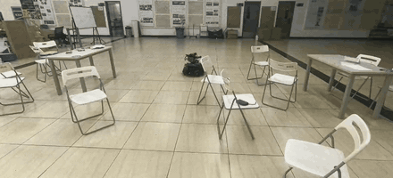

# neupan_cpp

Original Chinese [Readme](https://github.com/zhangkaiyuan007/neupan_cpp/blob/main/README.md)

`neupan_cpp` is a complete reproduction of the **[NeuPAN](https://github.com/hanruihua/NeuPAN)** algorithm (DUNE + NRMP + PAN). **NO PyTorch or cvxpy** required at runtime, so we can run it on lightweight computers like Intel NUC and coexist with robot's autonomy stack. 

This repo consists of a standalone core library (`libneupan`) and a ROS 2 node (`neupan_cpp_ros`).

> Differential drive (rectangular robot + global path reference) has been implemented and validated in simulation.
> Omnidirectional drive is implemented, matches upstream Python frame by frame, and runs on an omnidirectional sentry test car at 1.5 m/s. See [Project Status and Roadmap](https://github.com/zhangkaiyuan007/neupan_cpp/blob/main/README_en.md#project-status-and-roadmap).

<div align="center">
<table>
  <tr>
    <td align="center">
      <a href="https://b23.tv/tUGI5hV"></a>
      <br>Simulation demo
    </td>
    <td align="center">
      <a href="docs/media/omni_sentry.mp4"></a>
      <br>On the omnidirectional sentry test car
    </td>
  </tr>
</table>
</div>

## Quick start

Dependencies: Eigen 3.4, [osqp](https://github.com/osqp/osqp) + [osqp-eigen](https://github.com/robotology/osqp-eigen), yaml-cpp, GTest (for test), and ROS 2 Humble.

```bash
# osqp
cd ~
git clone https://github.com/osqp/osqp
cd osqp
mkdir build
cd build
cmake -G "Unix Makefiles" ..
cmake --build .
sudo cmake --build . --target install
```

```bash
# osqp-eigen
cd ~
git clone https://github.com/gbionics/osqp-eigen.git
cd osqp-eigen
mkdir build
cd build
cmake ../
make
sudo make install
# refresh the loader cache, or neupan_node cannot find libOsqpEigen.so
sudo ldconfig
```

```bash
# In your ros2 workspace
cd src
git clone https://github.com/zhangkaiyuan007/neupan_cpp.git
colcon build
source install/setup.bash
```

### Training a DUNE Model for Your Robot

The DUNE network encodes the robot's shape directly into its weights, so you must **train a model using your own robot's dimensions**. Train it once using the upstream Python tools, then export it to the `NPTF` format required by this repository:

```bash
python tools/export_dune_weights.py model_5000.pth your_robot.bin your_planner.yaml
```

The footprint is taken from the yaml's `robot` section (`vertices`, or `length`/`width`/`wheelbase`) and must be the one the checkpoint was trained for. It is stored in the file and checked against the footprint configured in `planner.yaml` on load; a mismatch is an error.

## Usage

```bash
ros2 launch neupan_cpp_ros neupan.launch.py

```

| Direction | Topic                                                        | Type                                                  |
| --------- | ------------------------------------------------------------ | ----------------------------------------------------- |
| Input     | `/scan`                                                      | `sensor_msgs/LaserScan` (Obstacle points)             |
| Input     | `/points`                                                    | `sensor_msgs/PointCloud2` (Obstacle points in any frame, z dropped; instead of `/scan`) |
| Input     | `/initial_path`                                              | `nav_msgs/Path` (Global reference line)               |
| Input     | `/neupan_goal`                                               | `geometry_msgs/PoseStamped` (Straight line reference) |
| Input     | `/neupan_waypoints`                                          | `nav_msgs/Path` (Waypoint polyline)                   |
| Input     | `/neupan_pause`                                              | `std_msgs/Bool`, true: hold still without planning (another controller is driving, say); planning resumes from rest |
| Output    | `/neupan_cmd_vel`                                            | `geometry_msgs/Twist`, remapped to `/cmd_vel` in the launch file |
| Output    | `/neupan_arrive`                                             | `std_msgs/Bool`, published every cycle, stays true after arrival until the path is replaced |
| Output    | `/neupan_plan`                                               | `nav_msgs/Path`, the optimized trajectory, stamped from the current pose one `step_time` apart, empty when stopped; a trajectory tracker can follow it |
| Output    | `/neupan_initial_path`, `/dune_point_markers` …              | Visualization                                         |

The planner configuration keeps `planner.yaml`'s key names, supports `kinematics: diff` and `omni` (a convex polygon footprint can be given as `vertices`), only `curve_style: line` is supported, and `loop: true` is not ported. The combinations `d_min < 0`, `d_max < d_min`, `eta > 0` with `d_max <= 0`, and `collision_threshold <= 0` throw on load.

Key tuning parameters: `collision_threshold` (hard emergency stop distance), `adjust.d_max` / `d_min` (how close it can get to obstacles), `ref_speed`, and `max_speed`.

Node parameters: `config_file` and `dune_checkpoint` are required and throw when missing. `scan_timeout` defaults to 0.5 s, after which the obstacle points are cleared and the robot stops. `solver_fail_grace` defaults to 5 consecutive failed solves before stopping. `lookahead` (default 0) is the delay before a command takes effect [s]: the plan starts where the last command will have taken the robot by then, and `/neupan_plan` is stamped that much later.

### Reference Global Planner (Optional)

`astar_global_node` subscribes  `/map`, inflates it based on the robot's radius, and runs A* algorithm after subscribe `/goal_pose`, then publish the resulting path to `/initial_path`.

## Motivation

The official implementation uses Python + PyTorch + cvxpy, which consumes excessive resources on a real robot:

* **Memory:** The Python version has a large memory cost. On a Sentry NUC already running autoaim and perception tasks, the performance drops significantly.
* **Latency & Jitter:** cvxpy reconstructs and standardizes the optimization at every single frame, causing big lag.

This project aims to provide a **lightweight**, **determined**, C++ implemented NeuPAN, leaving computational resources for other tasks on real robot.

## Performance

### Correctness

Item-by-item comparison against the original Python implementation under identical inputs (reproducible via unit tests `test_dune`, `test_nrmp`, and `test_replay`):

| Inspection Item                 | Difference from Python                                       |
| ------------------------------- | ------------------------------------------------------------ |
| DUNE MLP layer-by-layer output  | Max abs err **1.9e-7** (float32 aligned with PyTorch)        |
| DUNE full forward (µ, distance) | err **~3.6e-7**, obstacle point selection **identical**      |
| NRMP single-frame action        | err **~1.3%**, objective function relative err **~1e-4**     |
| 50 frame open-loop replay, upstream nominal control synced each frame | Average action err **< 1%**, minimum distance matches frame-by-frame within 0.05 m |

The NRMP residual comes from using a different but equivalent QP solver backend (OSQP instead of cvxpy/ECOS).

### Efficiency

Platform: **AMD Ryzen 9 9955HX** 

single corridor scenario, with 1100 obstacle points, prediction horizon `T = 10`, `iter_num = 2`:

| Phase                 | Python (PyTorch/cvxpy) | neupan_cpp | Speedup   |
| --------------------- | ---------------------- | ---------- | --------- |
| DUNE Forward          | 657 µs                 | 336 µs     | **~2.0×** |
| NRMP Solution         | 4609 µs                | 790 µs     | **~5.8×** |
| Full Planning Frame   | ~7.9 ms                | ~2.3 ms    | **~3.5×** |
| **Peak Memory (RSS)** | **386 MB**             | **9 MB**   | **~43×**  |

Without  `import torch` / `cvxpy`, inter-frame jitter is drastically lower. The QP is pre-assembled and warm-started, there's no per-frame reconstruction issue.

> End-to-end benchmark data on an Intel NUC is still pending, **we welcome contributions!**

* You can reproduce these results using the built-in benchmarking tools: `libneupan/tools/bench.cpp` and `libneupan/tools/bench_python.py`.
* Alternatively, run the full pipeline and monitor via tools like ```top/htop/btop```.

## C++ Porting Details (vs. Original Python)

| Feature             | Original Python                                              | neupan_cpp                                                   |
| ------------------- | ------------------------------------------------------------ | ------------------------------------------------------------ |
| DUNE Inference      | PyTorch `nn.Module`                                          | float32 MLP (Linear / LayerNorm / Tanh / ReLU) that reads exported weights. **NO libtorch**. |
| NRMP Solving        | cvxpy + cvxpylayers, **reconstructs & standardizes** the problem every frame (ECOS). | Hessian and sparse structure remain constant; only updates gradients/bounds/values in-place every frame with **warm start**. |
| Linear Algebra      | NumPy / Torch Tensors                                        | Eigen 3.4                                                    |
| Weights / Test Data | `.pth` / pickle                                              | Compact `NPTF` binary (exported once using `tools/export_dune_weights.py`). |
| Mem cost            | Python + Torch + cvxpy (~386 MB)                             | ~9 MB                                                        |
| Robustness          | Assumes the QP always solves successfully                    | Unconverged solutions are not passed down; output velocity is safeguarded by a **speed box**. |

DUNE explicitly runs in **float32** to numerically align with PyTorch.

## Project Status and Roadmap

**Implemented & Tested (Gazebo Differential Drive Simulation):**

* Differential drive, rectangular robot, straight line (`line`) reference
* DUNE + NRMP + PAN, solved via OSQP
* ROS 2 (Humble) node, topics compatible with upstream `neupan_ros`
* A reference global planner (A* → `/initial_path`)

**Implemented, matches upstream Python, runs on an omnidirectional sentry test car (1.5 m/s):**

* Omnidirectional drive (`omni`) with a convex polygon footprint (`vertices`). `/neupan_cmd_vel` carries `linear.x/y` in the base frame. One difference from upstream: a nominal that stands still or runs against the path is re-seeded along the path (see `InitialPath::seedOmni`); otherwise, starting from rest towards a goal behind it, upstream keeps driving forward.

**Differences from upstream:**

* The node passes the action it sent last and the time since to the planner (`NeuPANPlanner::Command`); the first input differs from it by at most `max_acce` times that time. Upstream bounds only consecutive inputs within one plan, so every replan may jump anywhere in the speed box (straight to `ref_speed` from rest, a sudden turn when the path changes), more than a chassis can follow. Calling `forward` without a `Command` behaves as upstream, which is what the parity tests do.
* `ipath.projected_reference: true` (default false, as upstream): the reference starts at the robot's projection on the path and steps `ref_speed` × `step_time` along it. Upstream starts at the first path point within `close_threshold`, often one behind the robot; with the speed cost on the magnitude only, not the direction, the plan swings side to side at full speed to fall back to it, and the robot weaves.

**Roadmap:**

* [x] Omnidirectional drive on a robot
* [ ] Ackermann adaptation
* [ ] TBD

## Architecture

```
neupan_cpp/
├── libneupan/         # Core Algorithm
│   ├── include/neupan/ 
│   ├── src/
│   ├── models/        # Exported DUNE weights (.bin)
│   ├── tests/         # Unit tests
│   └── tools/         # Weight exporting, benchmarks
└── neupan_cpp_ros/    # ROS 2 (Humble) Wrapper
    ├── src/neupan_node.cpp         #Planner node
    ├── src/astar_global_node.cpp   #Reference global planner
    ├── config/ 
    ├── launch/
    └── test/           

```

`libneupan` is a pure CMake library that can be used independently of ROS; `neupan_cpp_ros` is an `ament_cmake` package. Both are built together using ```colcon```.


## Acknowledgments and License

This project is a derivative work of **[NeuPAN](https://github.com/hanruihua/NeuPAN)** (Ruihua Han et al.). All credit for the algorithm goes to the original authors—please cite their T-RO 2025 paper if you use this work.
